# 📸 RobotCar Photo Gallery

[← Back to RobotCar README](README.md)

This gallery documents Om’s RobotCar from early prototypes to its completed build. **Click a thumbnail for the full-size photo.**

All 31 images are in [`projImages/`](projImages/) at the repository root.

### 🚗 Complete RobotCar and Chassis Views

<table>
  <tr>
    <td align="center" width="33%"><a href="projImages/robotcar-complete-side-profile-checkered-mat.jpg">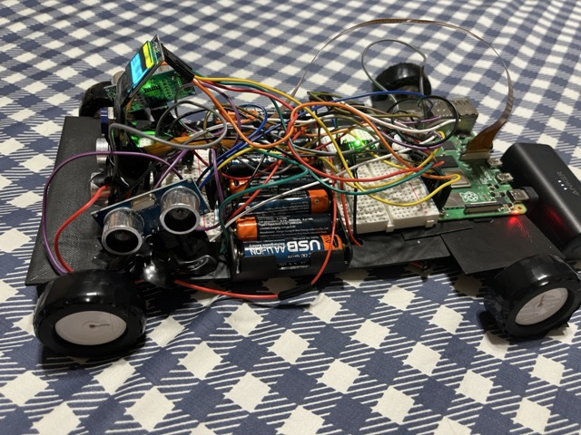</a> Complete robot, side view</td>
    <td align="center" width="33%"><a href="projImages/robotcar-complete-overhead-checkered-mat.jpg">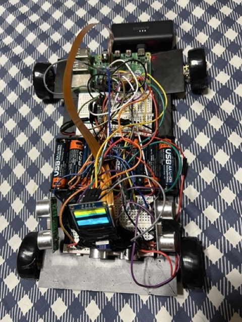</a> Complete robot, overhead view</td>
    <td align="center" width="33%"><a href="projImages/robotcar-carpet-front-left-angle.jpg">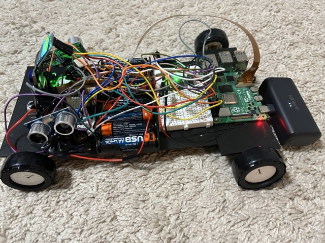</a> Front-left angle</td>
  </tr>
  <tr>
    <td align="center" width="33%"><a href="projImages/robotcar-carpet-front-overhead-view.jpg">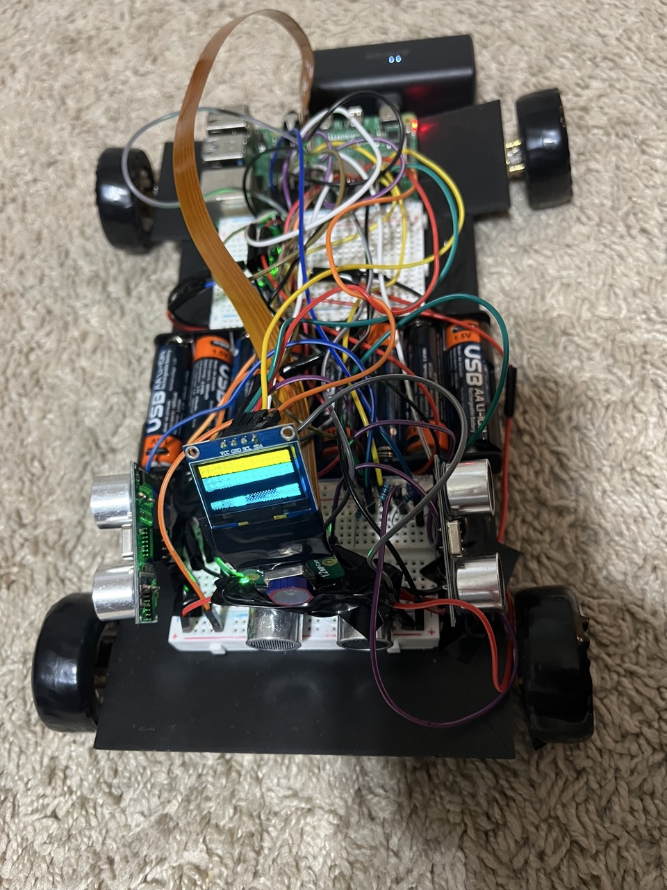</a> Front overhead view</td>
    <td align="center" width="33%"><a href="projImages/robotcar-carpet-left-side-profile.jpg">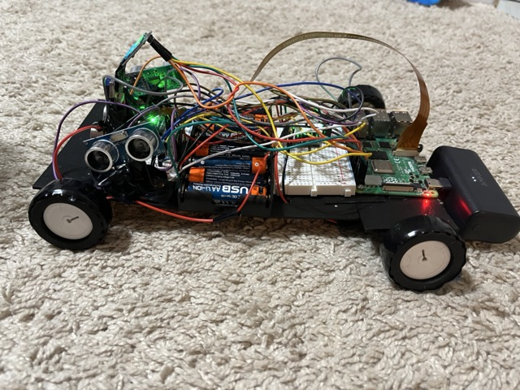</a> Left side profile</td>
    <td align="center" width="33%"><a href="projImages/robotcar-carpet-side-profile.jpg">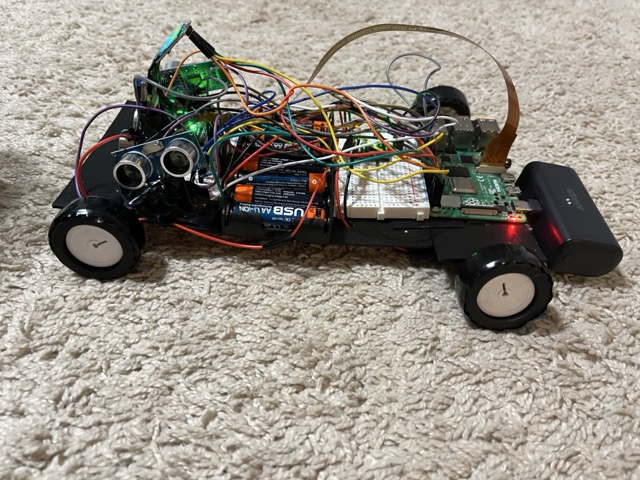</a> Side profile on carpet</td>
  </tr>
  <tr>
    <td align="center" width="33%"><a href="projImages/robotcar-carpet-side-chassis-view.jpg">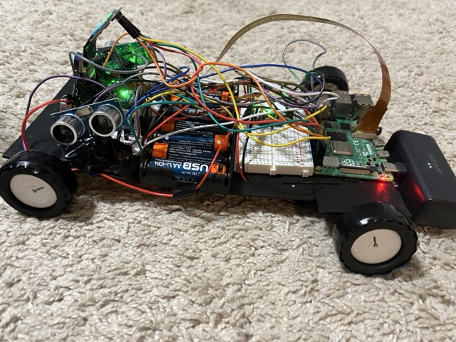</a> Chassis and electronics side view</td>
    <td align="center" width="33%"><a href="projImages/robotcar-carpet-overhead-angle.jpg">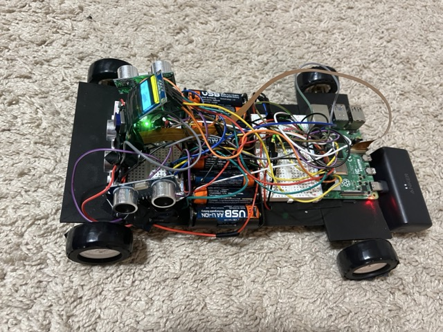</a> Angled overhead chassis view</td>
    <td align="center" width="33%"> Upper side of assembled car</td>
  </tr>
  <tr>
    <td align="center" width="33%"><a href="projImages/robotcar-checkered-mat-side-view.jpg">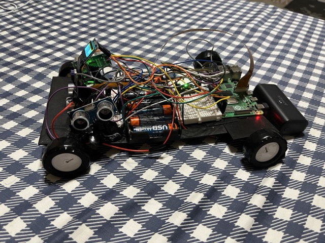</a> Side view on checkered mat</td>
    <td align="center" width="33%"><a href="projImages/robotcar-full-top-view-chassis-and-components.jpg">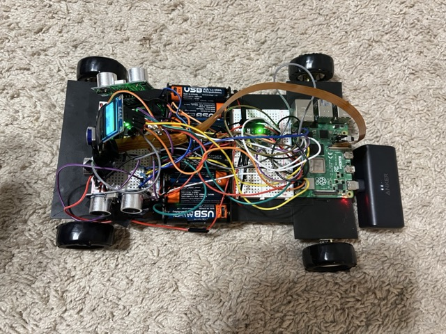</a> Full chassis and components</td>
  </tr>
</table>

### 📡 Ultrasonic Sensors and Display

<table>
  <tr>
    <td align="center" width="33%"><a href="projImages/robotcar-front-view-sensor-array-and-display.jpg">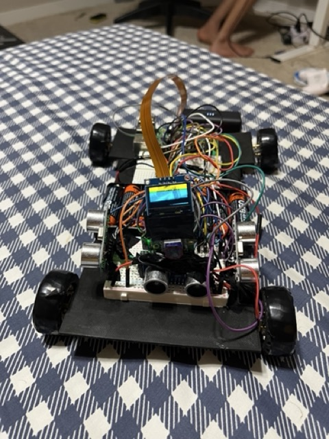</a> Front sensor array and display</td>
    <td align="center" width="33%"><a href="projImages/robotcar-front-ultrasonic-sensor-array-and-oled.jpg">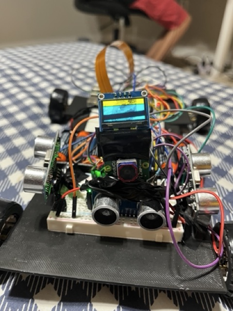</a> Ultrasonic sensor array and OLED</td>
    <td align="center" width="33%"> Ultrasonic sensor and servo</td>
  </tr>
  <tr>
    <td align="center" width="33%"><a href="projImages/robotcar-front-sensor-assembly-overview.jpg">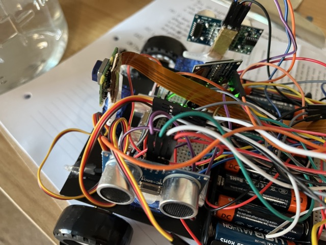</a> Front sensor assembly</td>
    <td align="center" width="33%"><a href="projImages/robotcar-front-sensor-and-battery-packs.jpg">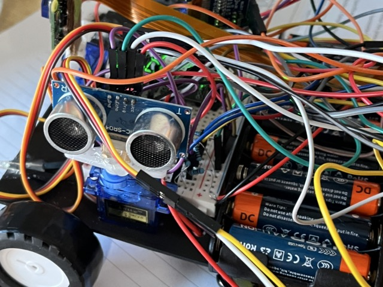</a> Front sensor and battery packs</td>
    <td align="center" width="33%"><a href="projImages/robotcar-servo-mounted-sensor-boards.jpg">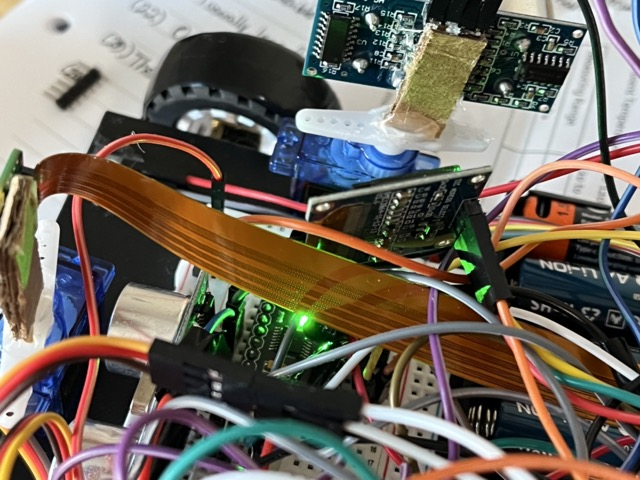</a> Servo-mounted sensor boards</td>
  </tr>
  <tr>
    <td align="center" width="33%"><a href="projImages/robotcar-checkered-mat-sensors-closeup.jpg">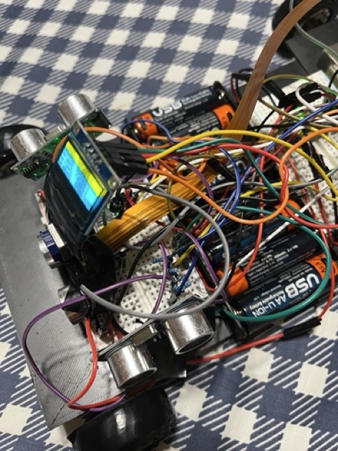</a> Sensors close-up</td>
    <td align="center" width="33%"><a href="projImages/robotcar-top-view-sensors-and-display.jpg">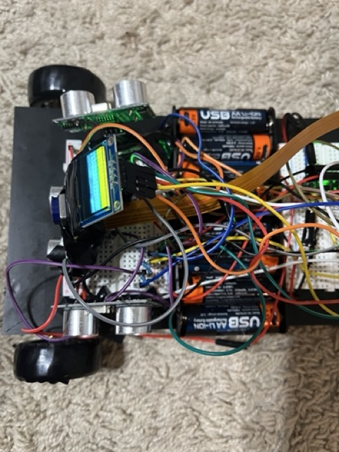</a> Sensors and display from above</td>
    <td align="center" width="33%"><a href="projImages/robotcar-angled-top-view-display-and-sensors.jpg">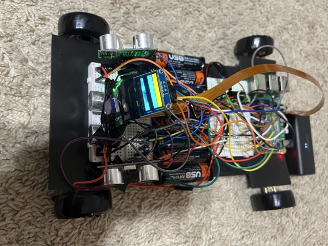</a> Display and sensors at an angle</td>
  </tr>
</table>

### 🔌 Raspberry Pi, Wiring, and Power

<table>
  <tr>
    <td align="center" width="33%"><a href="projImages/robotcar-angled-top-view-wiring-and-pi.jpg">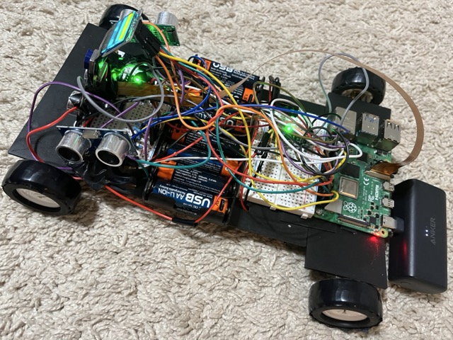</a> Wiring and Raspberry Pi</td>
    <td align="center" width="33%"><a href="projImages/robotcar-raspberry-pi-and-breadboard-overhead.jpg">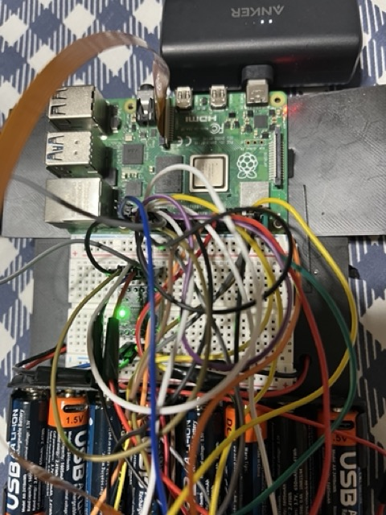</a> Raspberry Pi and breadboard</td>
    <td align="center" width="33%"><a href="projImages/robotcar-raspberry-pi-wiring-closeup.jpg">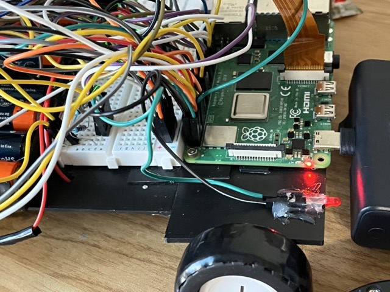</a> Raspberry Pi wiring close-up</td>
  </tr>
  <tr>
    <td align="center" width="33%"><a href="projImages/robotcar-raspberry-pi-ribbon-cable-closeup.jpg">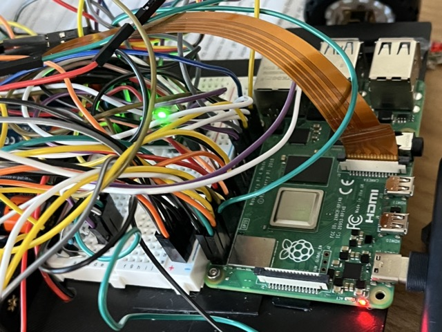</a> Raspberry Pi ribbon cable</td>
    <td align="center" width="33%"><a href="projImages/robotcar-ribbon-cable-and-wiring-overhead.jpg">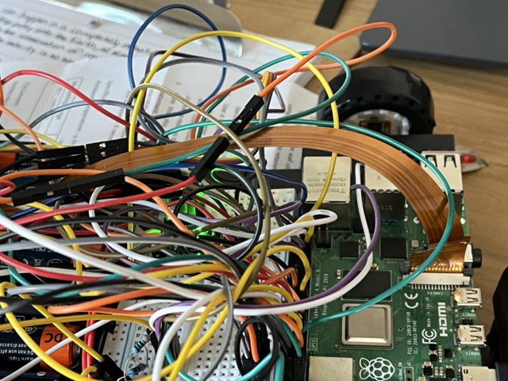</a> Ribbon cable and wiring overhead</td>
    <td align="center" width="33%"><a href="projImages/robotcar-side-electronics-and-power-view.jpg">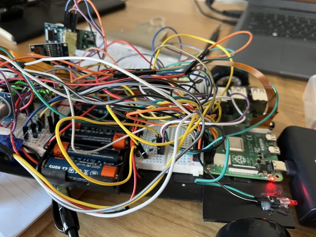</a> Electronics and power from the side</td>
  </tr>
  <tr>
    <td align="center" width="33%"><a href="projImages/robotcar-top-view-raspberry-pi-and-power-bank.jpg">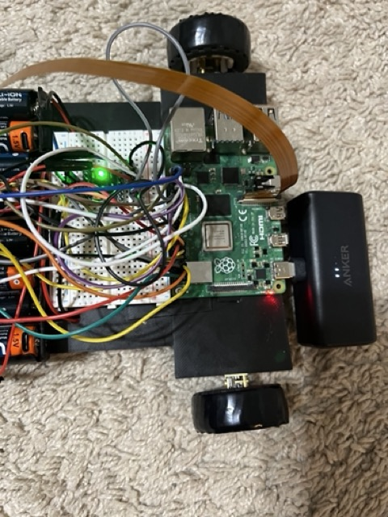</a> Raspberry Pi and power bank</td>
  </tr>
</table>

### 🛠 Early Prototypes and Development

<table>
  <tr>
    <td align="center" width="33%"><a href="projImages/robotcar-early-prototype-motors-and-controller.jpg">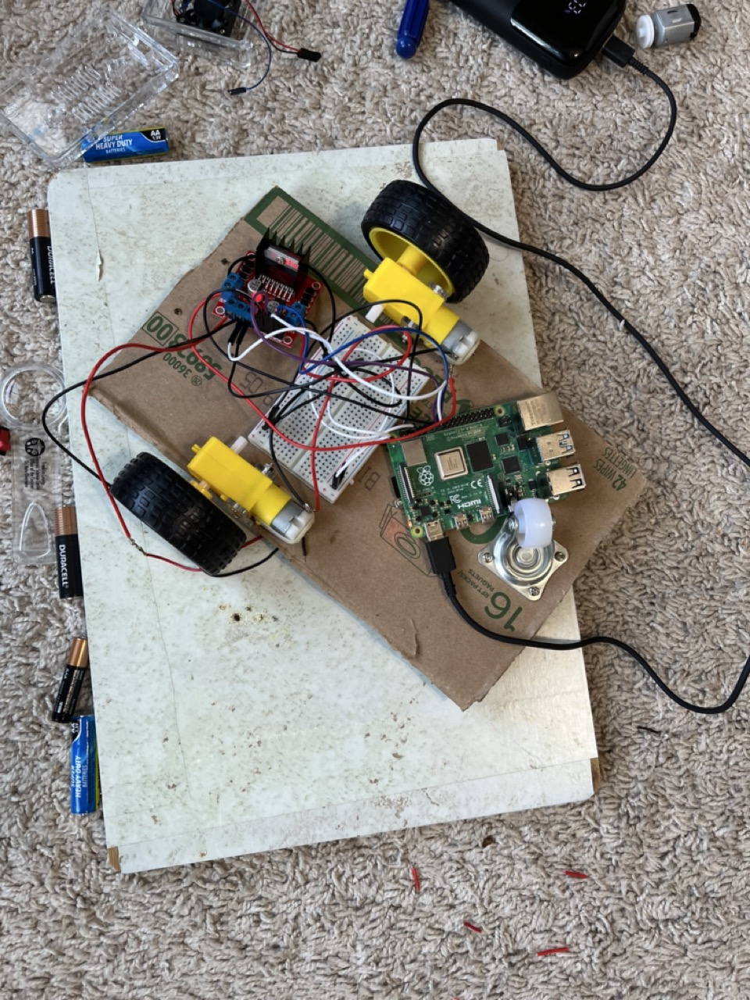</a> Early motors and controller prototype</td>
    <td align="center" width="33%"><a href="projImages/robotcar-early-prototype-motor-driver-and-pi-case.jpg">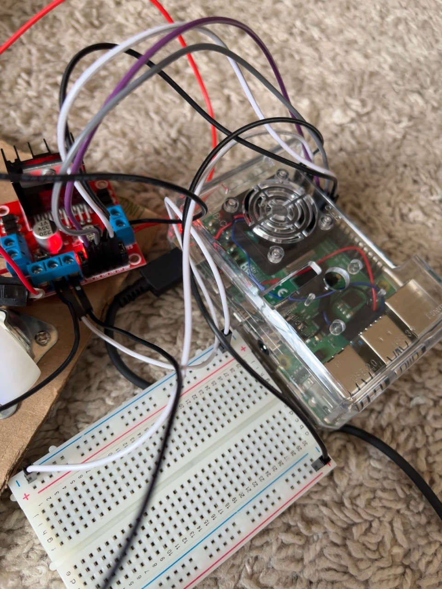</a> Early motor driver and Raspberry Pi case</td>
    <td align="center" width="33%"><a href="projImages/robotcar-prototype-pi-breadboard-and-power.jpg">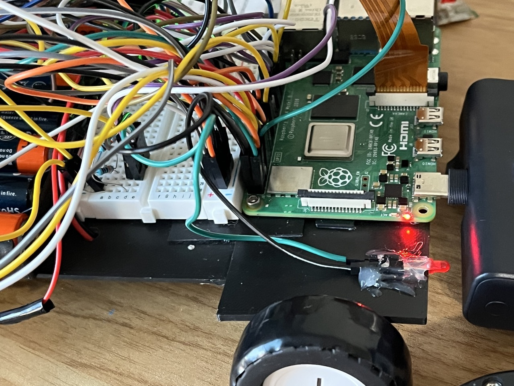</a> Prototype Raspberry Pi, breadboard, and power</td>
  </tr>
  <tr>
    <td align="center" width="33%"><a href="projImages/robotcar-prototype-ultrasonic-sensor-servo-mount.jpg">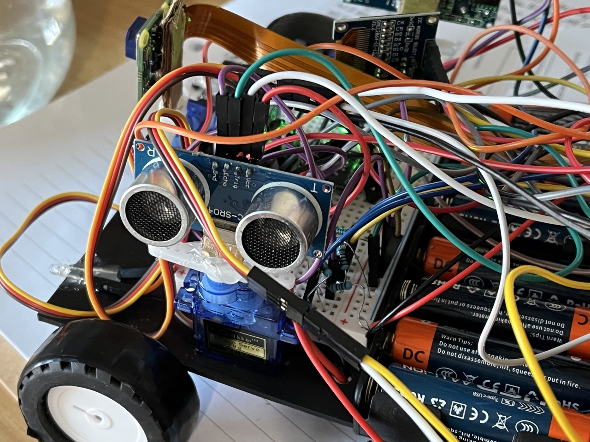</a> Prototype ultrasonic sensor servo mount</td>
  </tr>
</table>

