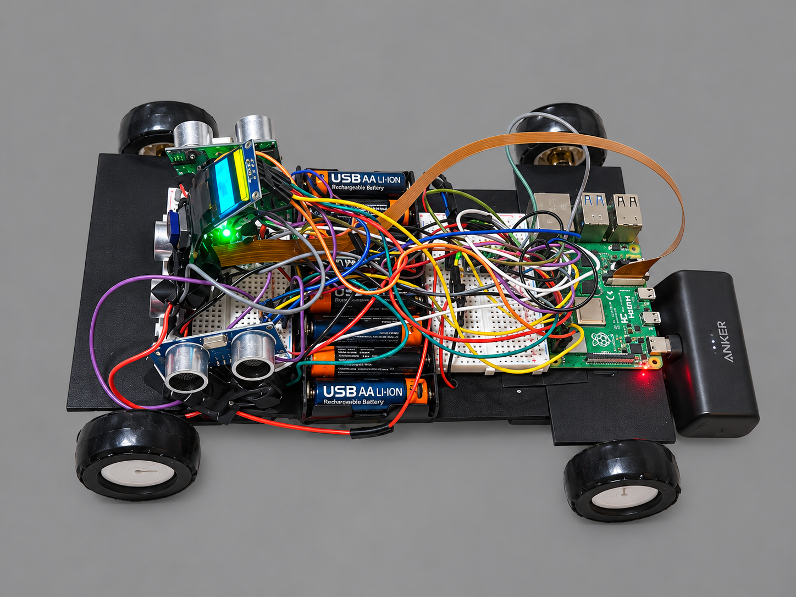

<p align="center">
  <a href="https://omspace.dev"><strong>OM.</strong></a> &nbsp;/&nbsp; SELECTED WORK &nbsp;/&nbsp; ROBOTICS
</p>

<h1 align="center">Autonomous RobotCar</h1>

<p align="center">
  <strong>A Raspberry Pi-powered four-wheel robot that senses obstacles and decides where to move next.</strong>
</p>

<p align="center">
  Python &nbsp;·&nbsp; Raspberry Pi &nbsp;·&nbsp; Embedded Systems &nbsp;·&nbsp; Autonomous Navigation
</p>

<p align="center">
  <a href="https://omspace.dev/pages/project-robot-car.html">Project story</a> &nbsp;·&nbsp;
  <a href="https://www.youtube.com/watch?v=gdj-aWxs_uI">Watch demo</a> &nbsp;·&nbsp;
  <a href="GALLERY.md">Photo gallery</a> &nbsp;·&nbsp;
  <a href="docs/BUILD.md">Build guide</a>
</p>

<table align="center">
  <tr>
    <td align="center">
      <a href="projImages/robocarheroimage.png">
        
      </a>
      <br>
      <sub>RobotCar — four-wheel autonomous obstacle-avoidance prototype</sub>
    </td>
  </tr>
</table>

<p align="center"><sub>2026 &nbsp; / &nbsp; ROBOTICS PROJECT &nbsp; / &nbsp; BUILDER &amp; PROGRAMMER: OM CHATTERJEE &nbsp; / &nbsp; IN DEVELOPMENT</sub></p>

---

**01 / OVERVIEW**

## The challenge

Making a robot move is one task. Making it choose a safe direction on its own is another.

I built RobotCar to explore the connection between **sensing, decision-making, and physical motion**. A Raspberry Pi controls four DC motors through two DRV8833 drivers. Three ultrasonic sensors measure nearby obstacles, and Python logic uses those readings to continue, stop, reverse, or turn toward a clearer route.

Manual keyboard control provides a way to test movement directly and temporarily override autonomous navigation.

<table align="center">
  <tr>
    <td align="center" width="25%"><strong>4</strong><br><sub>DRIVE MOTORS</sub></td>
    <td align="center" width="25%"><strong>3</strong><br><sub>ULTRASONIC SENSORS</sub></td>
    <td align="center" width="25%"><strong>2</strong><br><sub>DRV8833 DRIVERS</sub></td>
    <td align="center" width="25%"><strong>1</strong><br><sub>RASPBERRY PI 4B</sub></td>
  </tr>
</table>

---

**02 / SYSTEM DESIGN**

## From code to motion

| Layer | Hardware / software | Purpose |
| :--- | :--- | :--- |
| **Compute** | Raspberry Pi 4B, Python | Runs the control and navigation programs |
| **Movement** | 4 DC gear motors, 2 DRV8833 drivers | Drives and steers the four-wheel chassis |
| **Sensing** | 3 HC-SR04 ultrasonic sensors | Reads distances to the left, center, and right |
| **Power** | 2 motor battery packs | Supplies the drivetrain separately from the controller |
| **Control** | Keyboard input, autonomous logic | Provides direct driving and obstacle avoidance |

### How the car decides

The autonomous mode repeats a **sense → decide → move** loop:

1. **Drive.** Move forward while monitoring the left, center, and right sensors.
2. **Detect.** Stop when an obstacle is too close.
3. **Create space.** Reverse if extra room is needed.
4. **Compare.** Check which direction has more available space.
5. **Turn.** Rotate toward the clearer side.
6. **Continue.** Resume moving and keep checking the sensors.

This is reactive obstacle avoidance. Camera-based interpretation of the floor is a planned extension, not part of the current navigation system.

---

**03 / DEMONSTRATION**

## RobotCar in motion

See the car operating in a real environment.

<p align="center">
  <a href="https://www.youtube.com/watch?v=gdj-aWxs_uI">
    
  </a>
  <br>
  <sub>Click to watch the RobotCar demo on YouTube</sub>
</p>

---

**04 / CONTROL**

## Manual and autonomous driving

Manual mode helps verify the drivetrain independently from the navigation algorithm.

| Key | Action |
| :---: | :--- |
| `W` | Forward |
| `S` | Reverse |
| `A` | Left |
| `D` | Right |
| `SPACE` | Stop |
| `Q` | Quit |

Autonomous mode monitors all three sensors and changes direction when obstacles are detected. Manual input can temporarily override autonomous control.

---

**05 / GETTING STARTED**

## Run the project

Clone the current repository:

```bash
git clone https://github.com/gandalfrepos/RobotCar.git
cd RobotCar
```

Install the Raspberry Pi GPIO package:

```bash
sudo apt update
sudo apt install -y python3-gpiozero
```

| Task | Command |
| :--- | :--- |
| Test the four motors | `python3 motor_test.py` |
| Test ultrasonic sensors | `python3 ultrasonic_test.py` |
| Drive with the keyboard | `python3 drive.py` |
| Start obstacle avoidance | `python3 autonomous.py` |

> Run these scripts on the Raspberry Pi with the motor drivers, sensors, and power supplies wired according to the project documentation.

---

**06 / PROJECT MEDIA**

## Build gallery

The separate photo gallery documents **31 photos** of the finished chassis, sensors, Raspberry Pi, wiring, power system, and early development prototypes.

<p align="center">
  <a href="GALLERY.md"><strong>View the full photo gallery →</strong></a>
</p>

The original images are stored in [`projImages/`](projImages/).

---

**07 / DOCUMENTATION**

## Build and technical references

| Document | Description |
| :--- | :--- |
| [Parts list](docs/PARTS.md) | Components and hardware used |
| [Build & wiring guide](docs/BUILD.md) | Assembly and connections |
| [Software setup](docs/SOFTWARE.md) | Raspberry Pi configuration and dependencies |
| [Wiring diagram](docs/drawings/pi-wiring.png) | Circuit connection reference |
| [Source files](https://github.com/gandalfrepos/RobotCar) | Python programs and repository history |

---

**08 / DEVELOPMENT**

## Building in layers

The project was developed by testing individual subsystems before combining them:

- **Motor control:** Verify direction and steering before adding autonomous logic.
- **Sensor integration:** Check distance readings from each ultrasonic sensor.
- **Manual driving:** Confirm that hardware responds correctly to keyboard commands.
- **Autonomy:** Combine distance measurements and movement rules into an obstacle-avoidance loop.
- **Hardware iteration:** Move from early L298N driver prototypes to the more efficient DRV8833 motor drivers.

### Next: computer vision

Ultrasonic distance readings indicate how far away an obstacle is, but not what it is or whether a visible area is driveable. The planned next stage uses a camera to identify floor space and make more informed navigation decisions.

### Development tracking

[Open issues](https://github.com/gandalfrepos/RobotCar/issues) · [Closed issues](https://github.com/gandalfrepos/RobotCar/issues?q=is%3Aissue%20state%3Aclosed) · [Original project board](https://github.com/users/overcharged-coder/projects/2)

---

<p align="center">
  <a href="https://omspace.dev"><strong>OM.</strong></a><br>
  <sub>Built by Om Chatterjee · Robotics · Software · Learning by building</sub><br>
  <a href="https://omspace.dev/pages/project-robot-car.html">Project portfolio</a> &nbsp;·&nbsp; <a href="GALLERY.md">Photo gallery</a> &nbsp;·&nbsp; <a href="#autonomous-robotcar">Back to top ↑</a>
</p>
